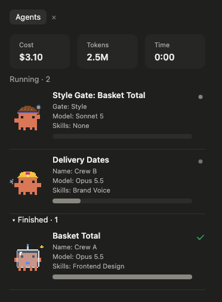
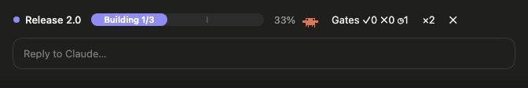

# Fun Savvy Progress

A live **agents panel** for Claude Code, for when you hand work to sub-agents: each one with its model and effort, a progress bar, the skills it used, and a little creature of its own that stays the same for that sub-agent. Totals for cost, tokens and time sit at the top, and a progress bar above the prompt shows a reported round at a glance.

This is a fork of **[savvy-progress by johnnyvizz](https://github.com/johnnyvizz/claude-kit/tree/main/plugins/savvy-progress)** (MIT), which made the progress bar, the agents panel and the creatures. This fork adds gate tracking, the skills each sub-agent used, a currency setting, and tidier headings. Credit for the original is johnnyvizz's.



## Install

At the prompt of a terminal session of Claude Code:

```
/plugin install fun-savvy-progress --marketplace couriard/claude-mods
```

Answer `y` to add the marketplace, pick a scope, and fill in the settings below when asked (all have defaults). In the Claude desktop app: **+** next to the prompt box → **Plugins** → **Add marketplace** → `couriard/claude-mods` → **Add plugin**.

`/agents-info` opens or closes the agents panel. It also opens by itself at the start of a session unless you turn that off.

## What it shows

- **Totals**: cost, tokens and time across the session's sub-agents.
- **Running and Finished sub-agents**: each headed by what it is working on, then its name, model and effort, and the skills it used ("None" when it used none), with a progress bar. Gates (checking sub-agents) say which kind of gate they are.
- **Skills and health**: the skills the session used, and the run's health when an orchestrator reports it.
- **The progress bar above the prompt**, once a workflow reports a round (see below): its name, phase and progress, a **Gates** counter (✓ passed, ✗ failed, ◷ running) and the crew size, which opens the panel.



## Settings

All can be changed later with `/config` → **fun-savvy-progress**.

| Setting | What it does | Default |
|---|---|---|
| **Panel language** | `auto` follows Claude Code's language, then your system's; or `en`, `ru`. | `auto` |
| **Open the agents panel at the start of every session** | Off keeps it closed until `/agents-info`. | On |
| **Currency** | `USD`, `GBP` or `EUR`. Costs are worked out in US dollars from a built-in price table and are a rough estimate, not a bill. | `USD` |
| **Exchange Rate** | How much of your currency one US dollar buys, for example `0.76` for pounds. Ignored for USD. | `1` |

## How a workflow feeds it

The panel watches sub-agents start, work and finish on its own; nothing is required. A workflow can add to it:

- **Sub-agent descriptions**: a description written `Crew A — what it does` shows "Crew A" as the sub-agent's name and "What It Does" as its heading. One with the word "gate" in it is shown as a gate.
- **Gate verdicts**: a gate's final report can carry `GATE-RECORD: {"task": "<what it checked>", "gate": "<gate name>", "verdict": "pass|fail|not applicable"}` lines, which feed the Gates counter.
- **The `progress` tool** (`mcp__fun-savvy-progress__progress`): an orchestrator reports a round (a `title`, a `phaseLabel` such as Building, and `total` and `done`) and the progress bar appears above the prompt. Fields left out keep their last value; `finished: true` closes the round.
- **The `step` tool** (`mcp__fun-savvy-progress__step`): a sub-agent reports its own steps (`done`, `total`, `note`). Without it, a sub-agent's bar moves with the calls it makes.

The two tools reach Claude only where Claude Code offers a mod's tools to the model; in some versions of the desktop app it does not, and then the panel still works but the progress bar above the prompt stays hidden.

## Licence

MIT. Original © johnnyvizz; changes in this fork © couriard. See [LICENSE](LICENSE).
