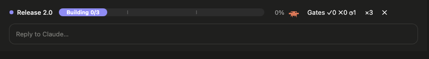
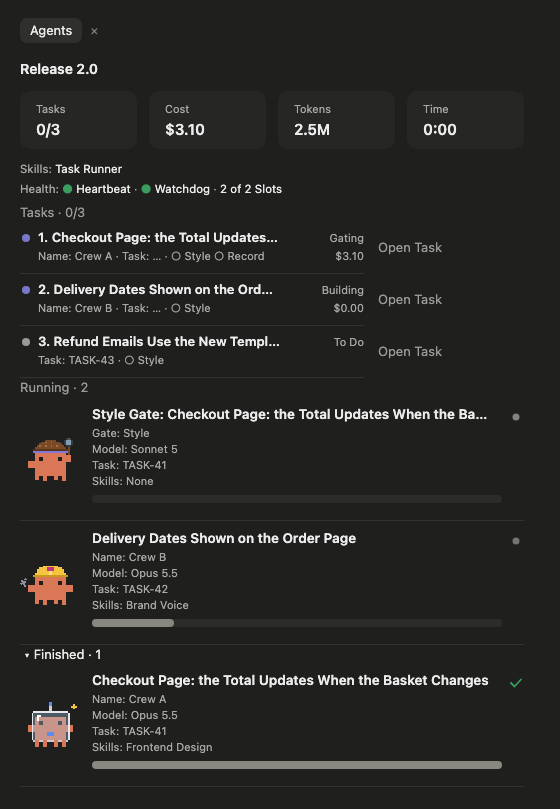

# Savvy Progress

A progress bar above the prompt and a live **agents panel** for Claude Code, for when you hand work to sub-agents. See each task of a round with its crew, its gates and its cost, and each sub-agent with its model, its progress, the skills it used and a little creature of its own.

This is a fork of **[savvy-progress by johnnyvizz](https://github.com/johnnyvizz/claude-kit/tree/main/plugins/savvy-progress)** (MIT), which made the progress bar, the agents panel and the creatures. This fork adds task rows, gate tracking, open-task links, per-sub-agent skills and a currency setting. Credit for the original is johnnyvizz's.





## Install

At the prompt of a terminal session of Claude Code:

```
/plugin install savvy-progress --marketplace couriard/claude-mods
```

Answer `y` to add the marketplace, pick a scope, and fill in the settings below when asked (all have defaults). In the Claude desktop app: **+** next to the prompt box → **Plugins** → **Add marketplace** → `couriard/claude-mods` → **Add plugin**.

`/agents-info` opens or closes the agents panel; it also opens by itself at the start of a session unless you turn that off.

## What it shows

- **The progress bar**, above the prompt, once a round is reported: its name, phase and tasks done, a **Gates** counter (✓ passed, ✗ failed, ◷ running) and the crew size, which opens the panel.
- **Totals**: tasks done, cost, tokens and time.
- **Tasks**: one row per task of the round, with its status, its crew, each gate it expects (○ expected, ◷ running, ✓ passed, ✗ failed, with the attempt count) and the crew's cost. With the **Task Link** setting, an **Open Task** button opens it in your task tracker.
- **Sub-agents**, running and finished: headed by the task each one works, then its name, model and effort, task and the skills it used ("None" when it used none), with a progress bar.
- **Skills and health**: the skills the session used, and the run's health when an orchestrator reports it.

## Settings

All can be changed later with `/config` → **savvy-progress**.

| Setting | What it does | Default |
|---|---|---|
| **Panel language** | `auto` follows Claude Code's language, then your system's; or `en`, `ru`. | `auto` |
| **Open the agents panel at the start of every session** | Off keeps it closed until `/agents-info`. | On |
| **Task Link** | Where a task opens when you click **Open Task**: a web address with `{id}` where the task's id goes, such as `https://app.clickup.com/t/{id}` or `https://linear.app/your-team/issue/{id}`. Empty, rows have no open button. | Empty |
| **Currency** | `USD`, `GBP` or `EUR`. Costs are worked out in US dollars from a built-in price table and are a rough estimate, not a bill. | `USD` |
| **Exchange Rate** | How much of your currency one US dollar buys, for example `0.76` for pounds. | `1` |

## How a workflow feeds it

The panel watches sub-agents start and finish on its own. For the task rows and gates it reads a few things your workflow can report; none is required.

- **The `progress` tool** (`mcp__savvy-progress__progress`): an orchestrator reports the round: a `title`, a `phaseLabel` (Building, Gating), and `tasks`, each with a `title`, an `id` (the id your board uses, which should also appear in that task's brief), a `crew` name, the `gates` it expects and a `status` (to do, building, gating, done, blocked). Fields left out keep their last value, and `finished: true` closes the round.
- **The `step` tool** (`mcp__savvy-progress__step`): a sub-agent reports its own steps (`done`, `total`, `note`). Without it, a sub-agent's bar moves with the calls it makes.
- **Sub-agent descriptions**: a description written `Crew A — what it does` shows "Crew A" as the sub-agent's name. One with the word "gate" in it is shown as a gate.
- **Report lines**: a gate's final report can carry `GATE-RECORD: {"task": "<id or title>", "gate": "<gate name>", "verdict": "pass|fail|not applicable"}` lines; a sub-agent's can carry `COST-RECORD: {"task": "<title>"}` lines, so its cost lands on the right task.

## Licence

MIT. Original © johnnyvizz; changes in this fork © couriard. See [LICENSE](LICENSE).
