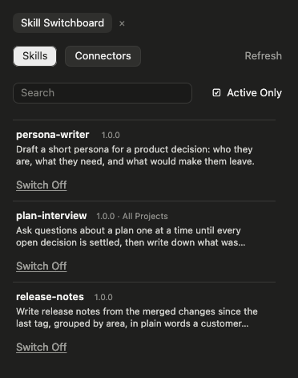
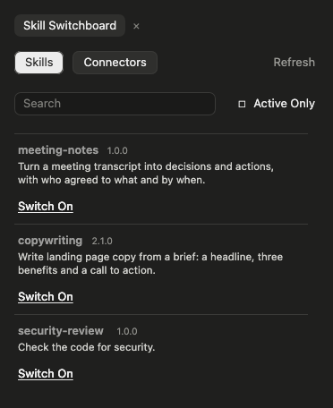
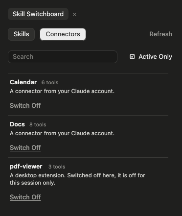

# Skill Switchboard

A Claude Code panel for your **skills** and **connectors**. Every row has a switch, a search narrows the list as you type, and an **Active Only** tick box flips between what is on and what is not. Point it at your own skills library and it installs a skill from there with one click.

Open it with `/skill-switchboard`.



## Install

At the prompt of a terminal session of Claude Code:

```
/plugin install skill-switchboard --marketplace couriard/claude-mods
```

Answer `y` to add the marketplace, pick a scope, and fill in the settings below when asked (all can be left empty). In the Claude desktop app: **+** next to the prompt box → **Plugins** → **Add marketplace** → `couriard/claude-mods` → **Add plugin**.

## What it shows

- **Skills and Connectors**, one tab each.
- **Search** narrows the rows by name or description as you type. The **✕** beside it clears it.
- **Active Only**: ticked, the rows are what is switched on in this project. Unticked, they are what is switched off here, followed by everything in your skills library that is not installed yet.
- **A row per skill**: its name, version, "All Projects" when it lives in `~/.claude/skills` (so it applies everywhere), its description, and a **Switch On / Switch Off** link.
- **Refresh**, top right, reads the library (or, on the Connectors tab, the connectors) again. The library's listing is otherwise kept for fifteen minutes.



### Connectors

The Connectors tab lists the session's connectors and their state ("8 tools", "Needs signing in", "Failed to connect"). Every connector has a switch. Connectors from your Claude account use the desktop app's own connector switch, taking effect from your next message. Others (desktop extensions, plugin or project servers, ones built into the app) are switched off by the panel itself for this session: their tools are moved out of Claude's list and every call to them is refused until you switch them back on or the session ends. Their own settings are never changed.



The app's switch also becomes the default for new sessions, so the panel records each connector's state before its first change and puts it back when the session ends. If the session ends without that step (the app force-quit), switch it back from the panel next time. Connectors need the desktop app; in a terminal-only session the tab says it could not list them.

## Settings

Claude Code asks for these when you install. Both can be left empty and changed later with `/config` → **skill-switchboard**.

| Setting | What to put | Default |
|---|---|---|
| **Library Location** | Where your skills library lives (see below). Empty, the panel works for installed skills and connectors, and shows a note where the library would be. | Empty |
| **Skills Folder** | The folder inside the library that holds the skills, one folder per skill, each with a `SKILL.md`. Empty when the skills sit directly in the library. | Empty |

### Where your library can live

Write the location however your library is kept; the panel works out which kind it is.

| Kind | Write it like | How it is read |
|---|---|---|
| A folder on this computer | `~/skills` | Directly. Synced cloud folders (iCloud Drive, Dropbox, OneDrive, Google Drive) and mounted network drives are folders too. |
| A server you reach over ssh | `my-server:/srv/skills` | Over ssh (a host name or an alias from your `~/.ssh/config`), which must connect without a password prompt. |
| A GitHub, GitLab or Bitbucket repository | `github:you/skills`, `gitlab:you/skills`, `bitbucket:you/skills`, or the repository's web address | Cloned once into `~/.claude/skill-switchboard/libraries`, then brought up to date whenever you press **Refresh**. |
| Any other git repository | `https://git.example.com/team/skills.git`, `git@host:team/skills.git` | The same way. |
| A download | `https://example.com/skills.zip` | Downloaded and unpacked into the same place, and fetched again on **Refresh**. A zip holding one top folder (as a repository's download does) is read from inside it. |

A private repository works wherever this computer's git can already reach it (an ssh key, or `gh auth login` then `gh auth setup-git`). Reading a library needs `python3`, and installing from it `rsync`; a repository needs `git`, a download `curl` and `unzip`. All come with macOS and most Linux systems. The panel only ever reads from your library; it never writes to it.

**Example:** Anthropic's own skills, `github:anthropics/skills` with Skills Folder `skills`.

## What a switch does

- A skill is **on** when its folder is in the project's own `.claude/skills` or in `~/.claude/skills`, and the project's `.claude/settings.json` does not say `"off"` for it under `skillOverrides`.
- **Switch On from the library** copies the folder into the project's own `.claude/skills/<name>`, leaves a small receipt (`.from-vault.json`) beside it, and takes any `"off"` out of `settings.json`. A folder already there that did not come from the library is left alone.
- **Switch Off** writes `"off"` into `settings.json`. When the copy came from the library, the copy is deleted too; the library still has it. A skill you wrote by hand is never deleted, and nothing in `~/.claude/skills` is touched.
- Nothing is ever written to your library.

The project is the folder the session was opened in.

## In the terminal and the desktop app

Both draw the same layout. In the terminal the tabs, the tick box and the switches are pieces the panel draws itself and you click directly. The desktop app does not draw those yet, so there the panel uses the app's own buttons and links instead.

## Checks

From this folder:

```
claude plugin validate .
claude plugin test .
```

The checks run against a pretend computer and a pretend library; nothing on your disk is touched.

## Licence

MIT, by [couriard](https://github.com/couriard).
