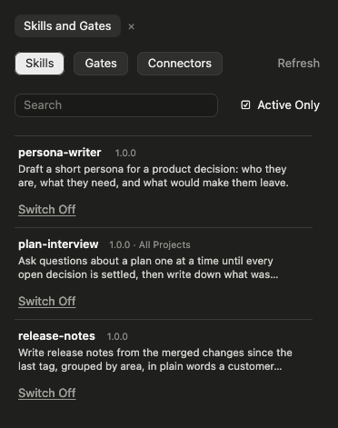
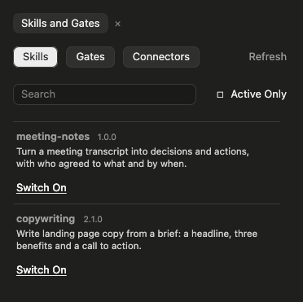
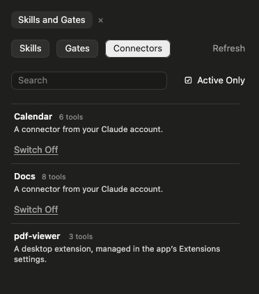

# Skills Panel

A Claude Code panel for your **skills**, **gates** and **connectors**. Every row has a switch, a search narrows the list as you type, and an **Active Only** tick box flips between what is on and what is not. Point it at your own skills library and it installs a skill from there with one click.

Open it with `/skills-panel`. (Claude Code keeps `/skills` for its own Settings page.)



## Install

At the prompt of a terminal session of Claude Code:

```
/plugin install skills-panel --marketplace couriard/claude-mods
```

Answer `y` to add the marketplace, pick a scope, and fill in the settings below when asked (all can be left empty). In the Claude desktop app: **+** next to the prompt box → **Plugins** → **Add marketplace** → `couriard/claude-mods` → **Add plugin**.

## What it shows

- **Skills, Gates and Connectors**, one tab each. A gate is a checking skill: one tagged `skill-type/gate`, or whose file says `Category: Gate`, or that came from your library's gates folder.
- **Search** narrows the rows by name or description as you type. The **✕** beside it clears it.
- **Active Only**: ticked, the rows are what is switched on in this project. Unticked, they are what is switched off here, followed by everything in your skills library that is not installed yet.
- **A row per skill or gate**: its name, version, "All Projects" when it lives in `~/.claude/skills` (so it applies everywhere), its description, and a **Switch On / Switch Off** link.
- **Refresh**, top right, reads the library (or, on the Connectors tab, the connectors) again. The library's listing is otherwise kept for fifteen minutes.



### Connectors

The Connectors tab lists the session's connectors and their state ("8 tools", "Needs signing in", "Failed to connect"). Connectors from your Claude account get a switch, which uses the desktop app's own connector switch and takes effect from your next message. Desktop extensions and plugin or project servers are listed without one, since they are managed in their own settings.



The app's switch also becomes the default for new sessions, so the panel records each connector's state before its first change and puts it back when the session ends. If the session ends without that step (the app force-quit), switch it back from the panel next time. Connectors need the desktop app; in a terminal-only session the tab says it could not list them.

## Settings

Claude Code asks for these when you install. All can be left empty and changed later with `/config` → **skills-panel**.

| Setting | What to put | Example |
|---|---|---|
| **Library Folder** | The folder holding your skills library. Empty, the panel works for installed skills, gates and connectors, and shows a note where the library would be. | `~/skills-library` |
| **Library Server** | Only if that folder is on another computer: the ssh host to reach it (a host name, or an alias from your `~/.ssh/config`). Empty, the folder is on this computer. | `my-server` |
| **Skills Folder** | The folder inside the library that holds skills, one folder per skill, each with a `SKILL.md`. | `Skills` |
| **Gates Folder** | The folder inside the library that holds gates. Empty if your gates sit with your skills, tagged `skill-type/gate`. | `Gates` |

A library on a server is read with ssh and `python3` on that server and copied with `rsync`; ssh must reach it without a password prompt (a key, or your ssh agent). A library on this computer needs `python3` and `rsync` here.

## What a switch does

- A skill is **on** when its folder is in the project's own `.claude/skills` or in `~/.claude/skills`, and the project's `.claude/settings.json` does not say `"off"` for it under `skillOverrides`.
- **Switch On from the library** copies the folder into the project's own `.claude/skills/<name>`, leaves a small receipt (`.from-vault.json`) beside it, marks a gate as a gate in its own file, and takes any `"off"` out of `settings.json`. A folder already there that did not come from the library is left alone.
- **Switch Off** writes `"off"` into `settings.json`. When the copy came from the library, the copy is deleted too; the library still has it. A skill you wrote by hand is never deleted, and nothing in `~/.claude/skills` is touched.
- Nothing is ever written to your library.

The project is the folder the session was opened in.

## In the terminal and the desktop app

Both draw the same layout. In the terminal the tabs, the tick box and the switches are pieces the panel draws itself and you click directly. The desktop app does not draw those yet, so there the panel uses the app's own buttons and links instead.

## Checks

From this folder:

```
claude plugin validate .
claude plugin test .
```

The checks run against a pretend computer and a pretend library; nothing on your disk is touched.

## Licence

MIT, by [couriard](https://github.com/couriard).
